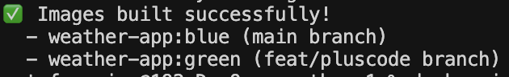
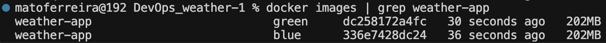
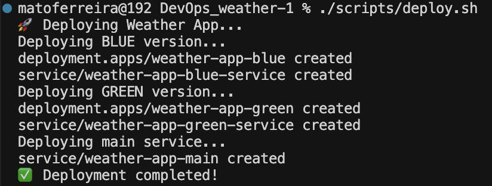
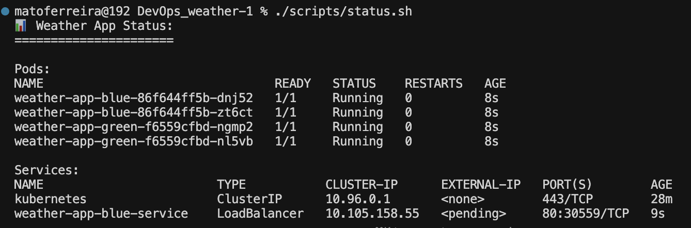
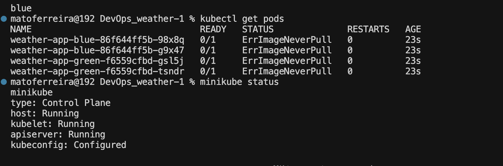
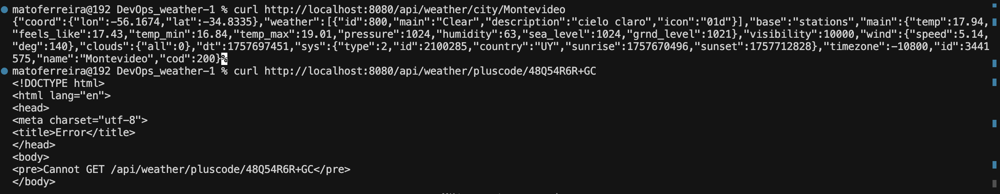
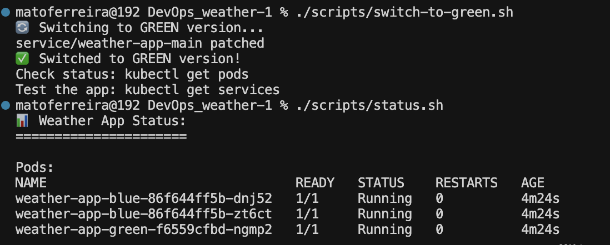
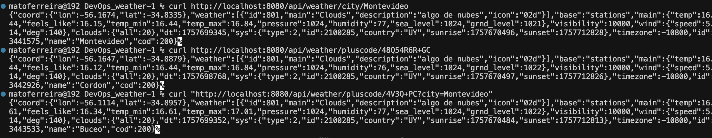
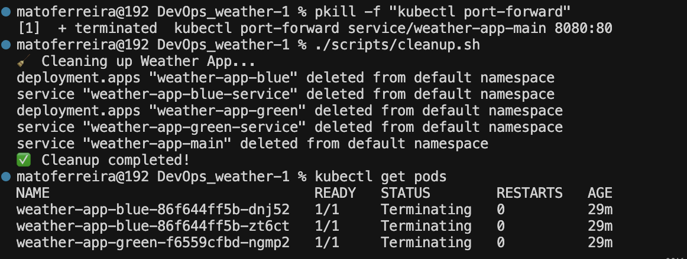

# 🌦️ Weather API - Despliegue Blue/Green

Despliegue blue/green en Kubernetes.
Matías Ferreira, Sebastián Forische, Lucas Martino
DevOps - Universidad Católica del Uruguay

## 📚 ¿Qué es un Despliegue Blue/Green?

El despliegue blue/green es una estrategia donde se tienen dos ambientes idénticos:
- **Blue**: Versión actual en producción (rama main)
- **Green**: Nueva versión con cambios (rama feat/pluscode)

El objetivo es redirigir el tráfico entre ambas versiones generando el menor downtime posible.

## 🏗️ Arquitectura

```
┌─────────────────┐    ┌─────────────────┐
│   Main Service  │    │   Blue Pods     │
│  (Load Balancer)│───▶│  (rama main)    │
└─────────────────┘    └─────────────────┘
         │
         ▼
┌─────────────────┐    ┌─────────────────┐
│   Green Pods    │    │   Green Pods    │
│ (feat/pluscode) │    │ (feat/pluscode) │
└─────────────────┘    └─────────────────┘
```

## 🚀 Cómo Desplegar

### 1. Prerequisitos
- Cluster de Kubernetes (minikube, kind, o cloud)
- kubectl instalado
- Docker instalado

### 2. Construir Imágenes
```bash
./scripts/build.sh
```

### 3. Desplegar Ambas Versiones
```bash
./scripts/deploy.sh
```

### 4. Verificar Estado
```bash
./scripts/status.sh
```

## 🔄 Operacion Blue/Green

### Cambiar a Versión Green
```bash
./scripts/switch-to-green.sh
```

### Cambiar a Versión Blue
```bash
./scripts/switch-to-blue.sh
```

### Ver estado actual
```bash
./scripts/status.sh
```

### Limpiar todo
```bash
./scripts/cleanup.sh
```

## 📋 Tutorial Paso a Paso

### Paso 1: Construir Imágenes Docker
```bash
# Esto construye ambas versiones
./scripts/build.sh
```

**Qué pasa:**
- Cambia a rama main → construye `weather-app:blue`
- Cambia a rama feat/pluscode → construye `weather-app:green`

### Paso 2: Desplegar en Kubernetes
```bash
./scripts/deploy.sh
```

**Qué pasa:**
- Crea 2 pods para versión blue
- Crea 2 pods para versión green  
- Crea servicio principal (apunta a blue inicialmente)

### Paso 3: Probar la Aplicación
```bash
# Obtener la IP del servicio
kubectl get services

# Probar con port-forward
kubectl port-forward service/weather-app-main 8080:80
```

Probar la API:
```bash
# Probar endpoint básico
curl http://localhost:8080/api/weather/city/Montevideo

# Probar endpoint de coordenadas
curl "http://localhost:8080/api/weather/coords?lat=-34.9011&lon=-56.1645"
```

### Paso 4: Cambiar Versiones
```bash
# Cambiar a green (feat/pluscode)
./scripts/switch-to-green.sh

# Volver a blue (main)
./scripts/switch-to-blue.sh
```

## 🔍 Entendiendo los Archivos

### Manifiestos de Kubernetes (`k8s/`)

**weather-app-blue.yaml:**
- Deployment con 2 réplicas
- Usa imagen `weather-app:blue`
- Servicio para versión blue

**weather-app-green.yaml:**
- Deployment con 2 réplicas  
- Usa imagen `weather-app:green`
- Servicio para versión green

**weather-app-main.yaml:**
- Servicio principal que enruta el tráfico
- Selector cambia entre blue/green
- Este es el que usan los usuarios

### Scripts (`scripts/`)

**build.sh:** Construye ambas imágenes Docker

**deploy.sh:** Despliega todos los recursos de Kubernetes

**switch-to-green.sh:** Cambia tráfico a green

**switch-to-blue.sh:** Cambia tráfico a blue

**status.sh:** Muestra estado actual

**cleanup.sh:** Borra todo

## 🎯 Conceptos claves utilizados

### 1. Service Selector
El servicio principal usa un selector para elegir a qué pods enrutar el tráfico:

```yaml
spec:
  selector:
    version: blue  # o green
```

### 2. Labels
Los pods están etiquetados para que el servicio los encuentre:

```yaml
metadata:
  labels:
    app: weather-app
    version: blue  # o green
```

### 3. LoadBalancer
Los servicios usan LoadBalancer para acceso externo (funciona con minikube, kind, etc.)

## 🧪 Testeando el Despliegue

### Probar Versión Blue (rama main)
```bash
# Cambiar a versión blue
./scripts/switch-to-blue.sh

# Hacer port-forward
kubectl port-forward service/weather-app-main 8080:80

# Probar endpoints de la versión blue
curl http://localhost:8080/api/weather/city/Montevideo
curl "http://localhost:8080/api/weather/coords?lat=-34.9011&lon=-56.1645"
```

### Probar Versión Green (rama feat/pluscode)
```bash
# Cambiar a versión green
./scripts/switch-to-green.sh

# Hacer port-forward
kubectl port-forward service/weather-app-main 8080:80

# Probar endpoints de la versión green (incluye Plus Code)
curl http://localhost:8080/api/weather/city/Montevideo
curl "http://localhost:8080/api/weather/coords?lat=-34.9011&lon=-56.1645"
curl "http://localhost:8080/api/weather/pluscode/48Q54R6R+GC"
curl "http://localhost:8080/api/weather/pluscode/4V3Q+PC?city=Montevideo"
```

## 🐛 Resolución de Problemas

### Verificar estado de Pods
```bash
kubectl get pods
kubectl describe pod <nombre-del-pod>
```

### Verificar estado de Servicios
```bash
kubectl get services
kubectl describe service weather-app-main
```

### Ver Logs
```bash
kubectl logs -l app=weather-app
```

### Problemas Comunes

1. **Pods no arrancan**: Verificar si las imágenes existen (`docker images`)
2. **Servicio no accesible**: Verificar si el LoadBalancer está listo
3. **Error de API key**: Actualizar la API key en los archivos YAML

## ✅ Evidencia del Funcionamiento

Esta sección documenta el proceso completo de testing realizado para verificar que el despliegue blue/green funciona correctamente.

Utilizamos MiniKube para crear los Clusters.

### 1. Verificación Inicial del Cluster

```bash
# Verificar que kubectl esté configurado
kubectl cluster-info
kubectl get nodes

# Resultado esperado: Cluster corriendo con nodos disponibles
```

### 2. Construcción de Imágenes Docker

```bash
# Construir ambas versiones
./scripts/build.sh
# Verificar que se construyeron
docker images | grep weather-app
# Resultado esperado:
# weather-app:blue
# weather-app:green
```
Evidencias:






### 3. Despliegue en Kubernetes

```bash
# Desplegar ambas versiones
./scripts/deploy.sh

# Verificar estado
./scripts/status.sh
# Resultado esperado: 4 pods corriendo (2 blue + 2 green)
```
Evidencias:


### 4. Resolución de Problemas de Imágenes

**Problema encontrado:** `ErrImagePull` - Las imágenes no se podían descargar.
Evidencia:


**Solución aplicada:**
```bash
# Agregar imagePullPolicy: Never a los archivos YAML
# En weather-app-blue.yaml y weather-app-green.yaml:
spec:
  containers:
  - name: weather-app
    image: weather-app:blue  # o green
    imagePullPolicy: Never  # ← Agregado
```

**Comandos ejecutados:**
```bash
# Limpiar despliegue anterior
./scripts/cleanup.sh

# Redesplegar con configuración corregida
./scripts/deploy.sh

# Verificar que los pods estén corriendo
kubectl get pods
# Resultado esperado: STATUS = Running
```

### 5. Testing de la Versión Blue (main branch)

```bash
# Cambiar a versión blue
./scripts/switch-to-blue.sh

# Hacer port-forward
kubectl port-forward service/weather-app-main 8080:80 &

# Probar endpoints básicos
curl http://localhost:8080/api/weather/city/Montevideo
# Resultado esperado: JSON con datos del clima

curl "http://localhost:8080/api/weather/coords?lat=-34.9011&lon=-56.1645"
# Resultado esperado: JSON con datos del clima

# Verificar que NO tiene Plus Code
curl http://localhost:8080/api/weather/pluscode/48Q54R6R+GC
# Resultado esperado: Error 404 (endpoint no existe en versión blue)
```
Evidencia:

### 6. Testing de la Versión Green (feat/pluscode branch)

```bash
# Cambiar a versión green
./scripts/switch-to-green.sh

# Verificar que cambió
./scripts/status.sh
# Resultado esperado: Current active version: green

# Probar endpoints básicos
curl http://localhost:8080/api/weather/city/Montevideo
# Resultado esperado: JSON con datos del clima

curl "http://localhost:8080/api/weather/coords?lat=-34.9011&lon=-56.1645"
# Resultado esperado: JSON con datos del clima

# Probar Plus Code (nuevo endpoint)
curl http://localhost:8080/api/weather/pluscode/48Q54R6R+GC
# Resultado esperado: JSON con datos del clima usando Plus Code
```
Evidencias:



### 10. Limpieza Final

```bash
# Matar port-forward
pkill -f "kubectl port-forward"

# Limpiar despliegue
./scripts/cleanup.sh

# Verificar limpieza
kubectl get pods
# Resultado esperado: No hay pods de weather-app
```

Evidencia:



## 📊 Resultados del Testing

### ✅ Funcionalidades Verificadas

- [x] **Construcción de imágenes**: Ambas versiones se construyen correctamente
- [x] **Despliegue en Kubernetes**: 4 pods corriendo (2 blue + 2 green)
- [x] **Versión Blue**: Endpoints básicos funcionan, Plus Code no
- [x] **Versión Green**: Endpoints básicos + Plus Code funcionan correctamente
- [x] **Cambio de versiones**: Switch entre blue/green funciona instantáneamente
- [x] **Limpieza**: Cleanup funciona correctamente

### 🔧 Problemas Resueltos

1. **ErrImagePull**: Resuelto agregando `imagePullPolicy: Never`
2. **Port-forward**: Resuelto reiniciando el port-forward cuando era necesario
